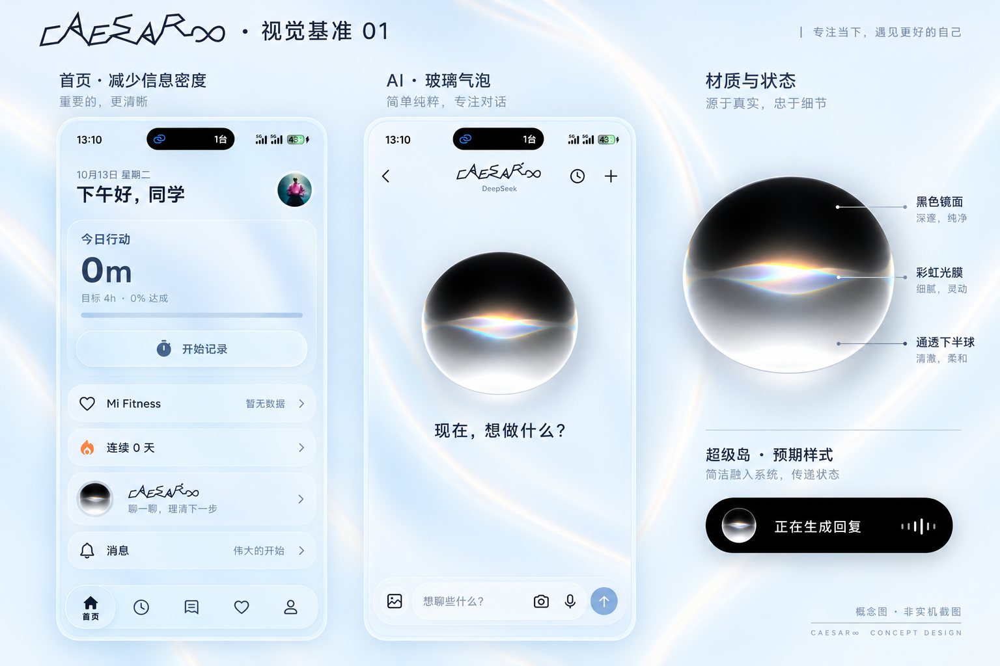

# Caesar 视觉基准 01

由内置 image_gen 生成，2026-10-13。此图为概念图，不是实机截图。用户主参考图为黑顶、中央彩虹光膜、透明下半球的 Siri 气泡；品牌参考为项目现有开屏艺术字。



## 约束

- 首页减少重复说明和信息密度，保留记录、健康、连续记录、AI 与消息的功能层级。
- 品牌展示复用开屏已有艺术字；生成图中的近似字形不能替代代码中的原始路径。
- 气泡以主参考图为视觉目标；实现仍需按实机材质和连续状态验收。
- 背景运动速度不放慢；发光质感来自细亮光芯和透明衰减光晕，呼吸由亮度变化表现。
- 超级岛仅展示静态图标和系统文字的预期样式，不暗示系统已经支持应用内动态折射。
- 图中卡片、比例、阴影与排布是待对照实现的视觉目标。源代码、已安装包、概念图是三个不同状态。

## 初次生成提示词

```text
Use case: ui-mockup. Create one exceptionally polished visual benchmark concept board for the existing Android app Caesar∞, using the supplied images as references, NOT a claim of a working screenshot. Wide landscape composition, high resolution, quiet pale ice-blue / porcelain-white background. Tasteful Chinese design board, generous whitespace. Three carefully aligned columns: two tall accurate flat mobile UI mockups (home and AI empty conversation) plus a narrower material-study column with one large close-up glass orb and one black Xiaomi island state strip. Minimal borderless presentation, no hands, no 3D angled phones, no promotional clutter.

REFERENCE ROLES:
Image 1 is the PRIMARY AUTHORITATIVE orb material reference. Extract only the glass bubbles shown inside it; ignore all its social-media UI, captions, named devices and logos. Reproduce the middle bubble's exquisite optical form: subtly flattened superellipse width/height about 1.2, nearly black mirror top dome with very soft curved gray transition, transmissive lower bowl, subtle dark peripheral glass thickness, local soft white bottom caustic, hairline refractive edge, neutral diffuse contact shadow. A THIN BUT VOLUMETRIC central prismatic light membrane with amber/pearl white upper crossing and cyan/lavender underside, tiny red/green fringes. This is a floating optical lens, not a black solid ball with a white gradient, not two skinny rainbow sine lines, not colorful smoke. Reference identity and material accuracy are crucial.
Image 2 is the EXISTING home UI, provided for app functions and the pale blue visual family; redesign its dense layout into spacious high-end editorial hierarchy. Preserve functions but remove redundant explanatory paragraphs. Never copy the existing background's opaque fabric-ribbon appearance.
Image 3 is the EXISTING launch brand. Reuse its angular, hand-drawn single-line CAESAR infinity wordmark exactly as closely as possible for standalone brand titles. Do not invent a new logo or use a normal sans-serif 'Caesar' title. The six-loop metallic logo is supporting existing identity only; it must not replace the glass orb.

HOME MOCKUP: realistic Android proportions about 390x844, safe area. Tiny date '10月13日 星期二', relaxed greeting '下午好，同学'. Main focus area '今日行动', an elegant large '0m', one discreet line '目标 4h · 0% 达成', slender progress indicator and one clear frosted rounded '开始记录' action. Spacious vertical rhythm. Health as one concise row 'Mi Fitness' and '暂无数据' with chevron, no paragraphs. One slim '连续 0 天' row. AI entry: 44dp optical orb left, the exact angular brand wordmark and one quiet line '聊一聊，理清下一步', arrow right. A restrained announcement row '消息' / '伟大的开始'. Bottom translucent native-style dock with five simple outlined icons and only selected '首页' text. No extra cards, charts, fake statistics or controls.

AI MOCKUP: top compact back arrow, exact brand wordmark with tiny 'DeepSeek' below, history and new-conversation icons. Center hero orb about 175dp visible width, faithful to Image 1; below it crisp '现在，想做什么？' and quiet empty space. Bottom thin refined translucent composer with placeholder '想聊些什么？', photo, camera, mic and single send button. No extra suggestion chips, panels, onboarding descriptions. Keep typography comfortably readable and correctly spelled.

BACKGROUND for both mockups: porcelain pale-blue atmosphere with luminous flowing LIGHT, distinctly not fabric ribbon. Use 2–3 fine bright light cores curving behind the layout, transparent continuously fading near halo and a very diffuse outer aura, restrained icy blue/white with slight warm fringe; no wide opaque bands, no parallel dark valleys, no metallic/folded surfaces, no neon laser glow. Communicate living light and gentle brightness breathing in a single still; current movement SPEED WILL BE KEPT in implementation, do not annotate slowing. Maintain excellent dark-text readability.

RIGHT MATERIAL COLUMN: large clean orb close-up, small diagram-free material notes only '黑色镜面', '彩虹光膜', '通透下半球'. Under it a physically plausible SMALL black rounded Xiaomi system island with 24dp static glass-orb artwork and native white text '正在生成回复'. Label this strip '超级岛 · 预期样式'. Do NOT show a huge orb breaking out of the system island or pretend full dynamic refraction exists there.
Heading at top 'Caesar∞ · 视觉基准 01' (brand part angular if possible). Small column captions '首页 · 减少信息密度', 'AI · 玻璃气泡', '材质与状态'. Small footer '概念图 · 非实机截图'. Render elegant balanced Chinese typography, meticulously spaced. Aim for product design craft and faithful materials, not a generic dribbble template.
```

## 定向修订提示词（曾尝试，未采用）

用户确认的是第一次生成的图，当前 PNG 已对齐到用户批准的附件。实现使用真实进度，超级岛右侧按后续要求接入状态表情与展开操作。

```text
Edit this concept board with only three precise corrections. Preserve all composition, all phone layouts, Chinese wording, exact angular brand wordmark, the glass-orb material, light-blue palette, breathing-light background appearance, and overall refined quality.
1. In the HOME phone's '今日行动' card, the value is 0m and 0% 达成. Make the progress bar an EMPTY very pale low-contrast neutral blue track, with no filled colored segment or glow. It must not look full.
2. In the black system island sample in the lower right, remove the entire white equalizer / audio waveform on the right. Keep only the small STATIC glass-orb icon and native white text '正在生成回复', with balanced spacing in the same black capsule. This is a GENERATION STATUS, not sound amplitude, and the system island concept must not imply extra controls.
3. Remove only the invented top-right slogan '专注当下，遇见更好的自己', leaving clean negative space there.
Do not change anything else. Maintain '概念图 · 非实机截图' label. High fidelity to the input, output one finished wide landscape benchmark board.
```
